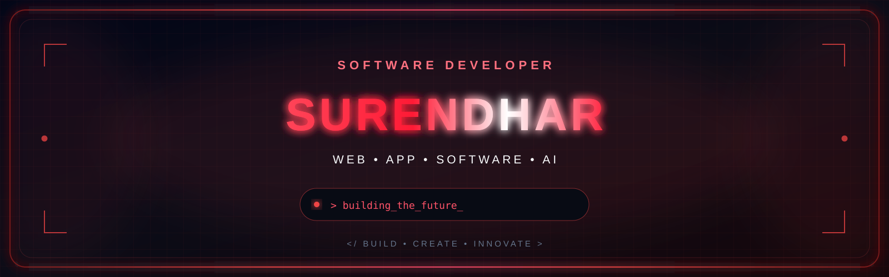
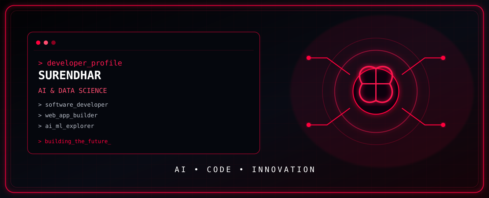
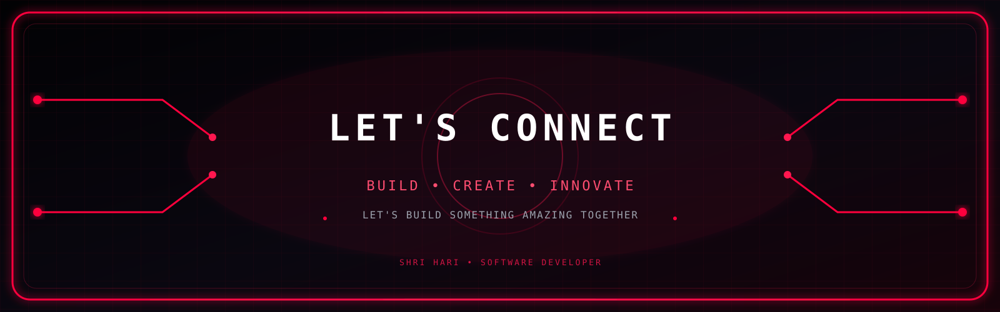

 

 

<h2 align="center">⚡ TECH STACK</h2>

 

<h2 align="center">🚀 WHAT I BUILD</h2>

| 🔥 Area | 💡 Focus |
|:---|:---|
| 🤖 Artificial Intelligence | AI-powered applications and intelligent systems |
| 🌐 Web Development | Modern full-stack web applications |
| 📱 App Development | Practical, mobile-friendly solutions |
| 🛰️ Data & APIs | Real-time data, APIs and automation |
| 🎨 UI/UX | Futuristic and user-friendly interfaces |

 

<h2 align="center">💻 PROJECTS</h2>

<h3>🔥 Industrial Fire Intelligence System</h3>

Satellite-powered industrial fire monitoring using NASA FIRMS and OpenStreetMap, with fire-risk analysis and location-based visualization.

**Tech Stack:** `Python` `FastAPI` `Angular` `Leaflet` `NASA FIRMS` `OpenStreetMap`

<h3>🤖 AI-Powered Applications</h3>

Building intelligent applications that combine AI, automation, APIs and modern interfaces to solve real-world problems.

**Focus:** `AI` `Machine Learning` `Automation` `Full Stack Development`

 

<h2 align="center">📊 GITHUB ACTIVITY</h2>

 

<h2 align="center">🐍 CONTRIBUTION JOURNEY</h2>

 

<h2 align="center">🎯 CURRENTLY EXPLORING</h2>

`Artificial Intelligence` • `Machine Learning` • `Full Stack Development` • `Cloud` • `Automation` • `UI/UX`

 

<h2 align="center">⚡ DEVELOPER MINDSET</h2>

**Think. Build. Break. Improve. Repeat.**

 

  

  

